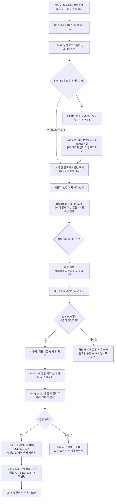

# MetaVault Datalake ST/L0 구조 변경 관리 사용 안내

## 1. 기능 목적과 적용 범위

이 화면은 등록된 테이블 메타정보와 PostgreSQL Datalake의 물리 ST/L0 테이블 구조를 비교하고, 구조 변경 계획을 미리 확인한 뒤 안전 조건을 만족하는 경우에만 반영하는 기능입니다.

- 위치: **Datalake 적재 운영 → 구조 변경 관리**
- 현재 대상: 활성 Datalake Target이 **PostgreSQL**인 경우
- 조회 대상: 등록 메타와 물리 ST/L0 테이블이 모두 존재하는 테이블
- 자동 적용 대상: **ST와 L0 양쪽 모두 비어 있고**, 변경 사항과 재생성 안전성이 확인된 테이블
- 데이터가 들어 있는 테이블의 운영 전환(TO-BE 생성·검증·승인)은 이 기능에서 제공하지 않습니다. 해당 테이블은 미리보기에서 TO-BE 경로로 표시되며 직접 적용할 수 없습니다.

상태 확인과 미리보기는 읽기 전용입니다. 물리 테이블 변경은 사용자가 최종 확인을 거쳐 **비어 있는 ST/L0에 구조 적용**을 실행한 뒤에만 시도됩니다.

## 2. 사용자 조작 방법

### 2.1 구조 변경 관리 열기

1. **Datalake 적재 운영** 화면에서 **구조 변경 관리**를 선택합니다.
2. 팝업이 등록된 테이블과 Datalake의 실제 상태를 조회합니다. 처음에는 `확인 중`이 표시될 수 있습니다.
3. 조회가 끝나면 상단에 `구조 변경 필요 N건`이 표시되고, 구조 변경이 필요한 테이블만 목록에 남습니다.
4. 검색창에서 시스템 코드, 원천 이름, postfix, Owner 또는 테이블 이름으로 범위를 좁힐 수 있습니다. 새 상태를 다시 확인하려면 **새로고침**을 선택합니다.

목록의 각 행에는 ST/L0 존재 상태와 적용 경로(예: 빈 테이블 적용 가능, TO-BE 검토 필요)가 함께 표시됩니다. `구조 변경 필요` 배지와 **변경 계획 보기** 버튼은 같은 줄에서 확인할 수 있습니다.

### 2.2 계획 검토

1. 대상 행의 **변경 계획 보기**를 선택합니다.
2. 계획 창에서 ST와 L0 각각의 존재 여부·행 상태, 등록 메타와의 차이, 차단 사유를 확인합니다.
3. 다음 항목을 특히 확인합니다.
   - 추가·삭제·변경된 컬럼과 컬럼 순서
   - L0 기본 키 변경 여부
   - ST/L0의 실제 데이터 존재 여부
   - 종속 객체 등 안전한 재생성을 막는 사유
4. 계획 상태가 **빈 테이블 직접 변경**이고 `READY`일 때만 적용 버튼이 활성화됩니다. `변경 없음`, `차단`, `TO-BE 전환 필요` 상태에서는 이 버튼으로 물리 구조를 변경할 수 없습니다.

계획 보기는 대상 DB에 DDL을 실행하지 않습니다. 현재 등록 메타와 현재 물리 상태를 비교해 결과를 보여줍니다.

### 2.3 빈 ST/L0에 적용

1. `비어 있는 ST/L0에 구조 적용`을 선택합니다.
2. 확인 창에서 대상 Owner/테이블과 양쪽 테이블의 빈 상태를 확인하고 승인합니다.
3. 적용이 성공하면 계획 창이 닫히고 결과 알림이 표시됩니다. 목록을 다시 조회하므로 변경된 구조 상태가 반영됩니다.
4. 오류가 나면 알림에 나온 사유를 확인합니다. 미리보기 이후 메타나 물리 구조가 바뀐 경우에는 기존 계획을 재사용하지 말고 **최신 계획을 다시 만드세요**.

### 2.4 닫기와 탐색

- 닫기 버튼, 팝업 바깥 영역 클릭 또는 가능한 경우 Escape로 창을 닫을 수 있습니다.
- 요청 처리 중에는 중복 적용이나 실수로 닫는 일을 막기 위해 관련 동작이 제한될 수 있습니다.
- 적용 확인 창이 열린 동안 Escape는 그 뒤의 계획 창까지 닫지 않습니다.

## 3. 사용자 조작부터 내부 처리까지

### 3.1 목록을 열었을 때

프런트엔드는 등록 메타를 페이지 단위로 읽고, 전체 identity(`system_cd`, `instance_name`, `postfix`, `owner`, `table_name`)를 사용해 같은 이름의 테이블을 구분합니다. 이어서 물리 상태를 일괄 조회합니다. ST와 L0가 모두 존재한다고 확인된 테이블만 대상으로 변경 상태 API를 호출하며, 여러 상태 요청은 동시에 최대 4개씩 처리합니다.

Backend는 활성 Target이 PostgreSQL인지 확인한 뒤 등록 메타로부터 목표 테이블 구조를 만들고 실제 PostgreSQL 카탈로그를 읽습니다. 컬럼 구조와 순서, null 허용 여부, 타입·길이·정밀도 및 L0 기본 키를 비교합니다. 이 단계에서 DDL을 실행하지 않습니다. 조회 실패나 확인할 수 없는 데이터 존재 여부는 빈 테이블로 간주하지 않습니다.

UI는 `needs_migration=true`인 행만 목록에 표시합니다. 현재와 같은 테이블, 아직 만들지 않은 ST/L0, 검사 실패 또는 지원하지 않는 Target은 변경 필요 목록에서 제외됩니다. 상단 건수는 전체 등록 테이블 수가 아니라 현재 구조 변경이 확인된 테이블 수입니다.

### 3.2 계획을 요청했을 때

선택한 테이블 identity를 보내 `/api/metadata/registered/datalake-migrations/preview`를 요청합니다. Backend는 다시 활성 PostgreSQL Target과 등록 메타를 읽고 실제 ST/L0 구조, 양쪽 행 존재 여부, 컬럼 차이, 기본 키, 종속 객체와 재생성 가능성을 검사합니다. 미리보기 결과와 메타/물리 상태 지문은 Control Plane의 `datalake_schema_migrations`에 계획 레코드로 저장되며, 누가 언제 만들었는지도 기록됩니다.

주요 분기는 다음과 같습니다.

| 조건 | 계획 결과 | 동작 |
|---|---|---|
| ST와 L0가 모두 없음 | 신규 생성 경로 | 이 관리 목록의 기존 테이블 변경으로 적용하지 않음 |
| ST/L0 중 하나만 존재 | 차단 | 먼저 물리 대상 상태를 복구·확인 |
| 데이터 존재 여부를 확인할 수 없음 또는 차단 사유 존재 | 차단 | 확인 불가를 빈 상태로 취급하지 않음 |
| 양쪽이 비어 있고 변경 없음 | 변경 없음 | 적용 버튼 없음 |
| 양쪽이 비어 있고 변경이 안전함 | 빈 테이블 직접 변경 (`APPLY_EMPTY` / `READY`) | 사용자 확인 후 적용 가능 |
| 양쪽 중 하나 이상에 데이터가 있음 | TO-BE 전환 필요 | 이 기능에서 직접 적용하지 않음 |
| 재생성에 필요한 종속 객체·컬럼 속성을 안전하게 보존할 수 없음 | 차단 | 물리 변경하지 않음 |

현재 데이터가 있는 테이블용 TO-BE 생성·검증·승인 및 운영 전환 절차는 별도 기능 범위입니다. 데이터가 들어 있는 테이블을 이 기능으로 비우거나 강제로 바꾸지 마세요.

### 3.3 적용 버튼을 승인했을 때

프런트엔드는 명시적 확인을 받은 뒤 `/api/metadata/registered/datalake-migrations/apply-empty?confirm=true`에 계획 ID를 보냅니다. 이 경로는 `metadata:write` 권한을 요구합니다(상태·미리보기 조회는 `metadata:read`). Backend는 다음을 재검증합니다.

1. 계획이 존재하고 아직 적용 가능한 `PREVIEWED` 상태인지 확인합니다.
2. 계획 결과가 `APPLY_EMPTY`와 `READY`인지 확인합니다.
3. 현재 Target이 계속 PostgreSQL인지 확인합니다.
4. 등록 메타의 지문이 계획 생성 때와 같은지 확인합니다.
5. PostgreSQL 트랜잭션 안에서 물리 테이블 지문, 존재 여부, 빈 상태와 종속성을 다시 검사합니다.
6. 두 테이블에 배타 잠금을 얻은 뒤 상태를 한 번 더 확인합니다. 상태가 달라졌거나 잠금을 얻지 못하면 적용을 중단합니다.

검증이 통과하면 등록 메타에서 ST/L0 DDL을 생성하고 한 트랜잭션에서 반영합니다. 추가 컬럼만 있고 기존 컬럼 속성·순서에 변화가 없으며 새 컬럼이 모두 nullable이고 끝에 추가되는 경우에는 `ALTER TABLE`로 반영할 수 있습니다. 컬럼 삭제·타입/속성·순서·기본 키 변경, 중간 삽입 또는 NOT NULL 추가처럼 재생성이 필요한 경우에는 양쪽이 비어 있고 종속 객체·지원하지 않는 기본값/generated/identity 속성이 없는 등 안전 조건을 충족할 때만 빈 테이블 쌍을 재생성합니다. 계획 적용에는 프로시저 DDL을 포함하지 않습니다.

PostgreSQL 대상의 DDL과 멱등성 표식은 같은 대상 DB 트랜잭션에서 커밋됩니다. 그 다음 Control Plane의 계획 상태·사용자·시각은 별도 트랜잭션으로 기록됩니다. 대상 DB 트랜잭션 안에서 오류가 나면 DDL은 롤백됩니다. 다만 대상 DB 커밋 뒤 최종 응답/감사 저장에 실패하면 실제 구조는 이미 바뀌었을 수 있습니다. 이 경우 임의로 DDL을 다시 실행하거나 새 계획을 만들지 말고 상태를 확인하세요. 같은 계획 ID의 재시도는 적용 표식으로 중복 DDL을 막고 감사 상태를 복구할 수 있습니다. 화면에서 성공 알림을 보기 전까지는 완료로 단정하지 말고, 응답 오류 시 관리자와 결과를 확인하세요.

## 4. 재확인 또는 중단이 필요한 경우

- **계획이 오래되었거나 `PLAN_STALE`**: 미리보기 뒤 메타 또는 물리 구조가 바뀐 경우입니다. 최신 상태를 다시 확인하고 새 계획을 만듭니다.
- **데이터가 있음 / TO-BE 전환 필요**: 이 기능의 빈 테이블 경로로 적용하지 않습니다. 별도의 데이터 이관·검증·승인 절차가 필요합니다.
- **데이터 존재 여부 확인 불가**: 조회 실패를 빈 테이블로 추정하지 않습니다. DB 접속·권한·상태를 확인합니다.
- **종속 객체 또는 안전 조건 차단**: 인덱스·제약·트리거·권한·뷰 등의 영향 범위를 검토하고 차단 사유를 해소하기 전까지 적용하지 않습니다.
- **활성 Target이 PostgreSQL이 아님**: 현재 구조 변경 계획 기능의 지원 대상이 아닙니다.
- **배타 잠금 실패**: 테이블을 사용 중일 수 있습니다. 안전한 작업 시간에 재시도하고, 반복되면 DBA와 조율합니다.

## 5. 안전 및 범위 요약

- 목록 조회와 미리보기만으로는 Datalake 물리 구조를 바꾸지 않습니다.
- 적용은 명시적 확인과 `metadata:write` 권한이 필요합니다.
- 빈 상태, 최신 메타/물리 지문, 종속성과 잠금을 적용 직전에 다시 확인합니다.
- 데이터가 있거나 상태를 알 수 없는 테이블은 직접 적용할 수 없습니다.
- 이 기능은 컬럼 구조와 필요한 L0 키 구조를 반영하며, 적재 실행·원천 데이터 수집·프로시저 생성은 수행하지 않습니다.
